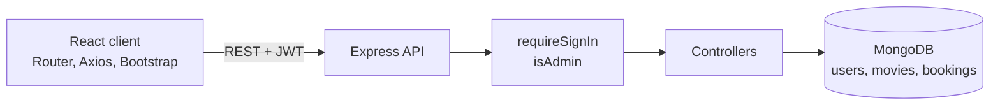

# Movie Ticketing Website


A full-stack MERN web app for browsing movies, choosing seats for a showtime and managing bookings, with separate customer and admin dashboards. It was built as a team project for CSE471 (System Analysis and Design) at BRAC University.


> **Which repository is which?** This repository holds the team's collaboration history. The deployment-ready version of the same app is [MERN-Movie-Booking](https://github.com/Arefashaily/MERN-Movie-Booking), so use that one to run the project.
>
> **Live demo:** the [frontend](https://movie-booking-frontend-phi.vercel.app/) is online, but its hosted API is currently unavailable, so movies don't load there.

## Features

**For customers**
- Browse **Now Showing** and **Coming Soon** movies, and filter them by genre
- Search by title, genre, director or cast
- Pick a showtime and choose seats on an interactive seat map that marks seats already taken
- See bookings in a personal dashboard and complete a simulated checkout by card, PayPal or net banking
- Register, log in, edit a profile and reset a forgotten password with a security question

**For admins**
- Create, edit and delete movies, including their showtimes and prices
- View and remove customer accounts, with admin accounts protected from deletion
- View all bookings, change their status and remove bookings that aren't confirmed

## How it works



- **Authentication:** passwords are hashed with bcrypt, and login issues a JWT that lasts 7 days. The client attaches it to requests through a shared Axios instance.
- **Access control:** `requireSignIn` checks the token and `isAdmin` checks the user's role. Matching private and admin route guards protect the React pages.
- **Seat availability:** before saving a booking, the API checks the seats against existing pending and confirmed bookings for that movie and showtime.
- **Booking lifecycle:** a booking starts as `pending`, becomes `confirmed` after checkout, and can be `cancelled` by an admin.

### REST API

| Resource | Endpoints under `/api/v1` | Access |
|---|---|---|
| Auth | `POST /auth/register`, `POST /auth/login`, `POST /auth/forgot-password` | Public |
| Profile | `PUT /auth/profile` | Signed in |
| Users | `GET /auth/all-users`, `DELETE /auth/delete-user/:id` | Admin |
| Movies | `GET /movie/get-movies`, `GET /movie/get-movie/:id`, `GET /movie/search` | Public |
| Movie management | `POST /movie/create-movie`, `PUT /movie/update-movie/:id`, `DELETE /movie/delete-movie/:id` | Admin |
| Seats | `GET /booking/booked-seats/:movieId` | Public |
| Bookings | `POST /booking/create-booking`, `GET /booking/user-bookings`, `POST /booking/process-payment` | Signed in |
| Booking management | `GET /booking/all-bookings`, `PUT /booking/update-status/:id`, `DELETE /booking/delete-booking/:id` | Admin |

## Tech stack

| Layer | Tools |
|---|---|
| Frontend | React 19, React Router 7, React Bootstrap, Axios, React Hot Toast |
| Backend | Node.js, Express 5, Mongoose 8 |
| Database | MongoDB |
| Security | JSON Web Tokens, bcrypt |
| Deployment | Vercel |

## Run it locally

You need Node.js and a MongoDB database.

```bash
git clone https://github.com/Arefashaily/MERN-Movie-Booking.git
cd MERN-Movie-Booking
npm install
npm install --prefix client
```

Create a `.env` file in the project root:

```env
PORT=8080
MONGODB_URI=your-mongodb-connection-string
DEV_MODE=development
JWT_SECRET=a-long-random-string
```

That repository's CORS setting only allows the deployed site, so change `origin` in `server.js` to `http://localhost:3000` for local use. Then start the API and the client together:

```bash
npm run dev
```

To add sample movies, run the seed script. **It deletes all existing movies first**, so only use it on a development database.

```bash
node scripts/seedMovies.js
```

New accounts are customers. To get an admin account, register normally and set that user's `role` to `1` in MongoDB.

## Limitations

This is a course project, and these parts would need work before real use:

- Payments are simulated, and no payment provider is connected.
- Password recovery relies on a security question.
- Seat checks and booking totals aren't hardened against concurrent or modified requests.

## Team

Siam Abdullah, Sultana Khairum Arefa and Ulfat Fatema, Department of Computer Science and Engineering, BRAC University.
